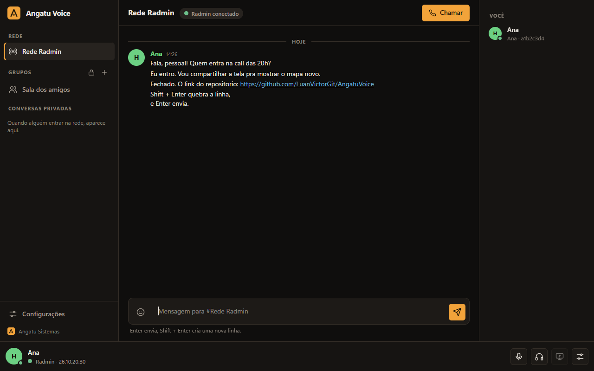
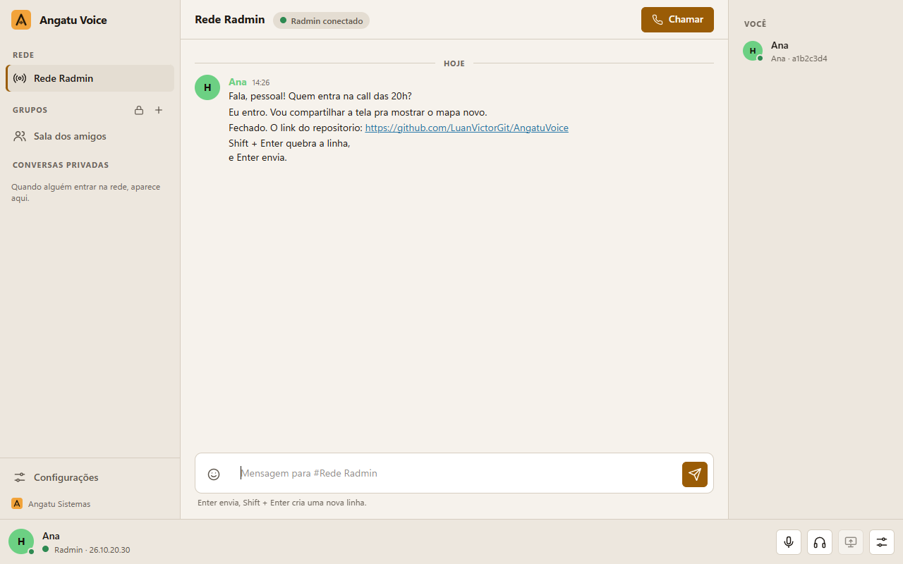
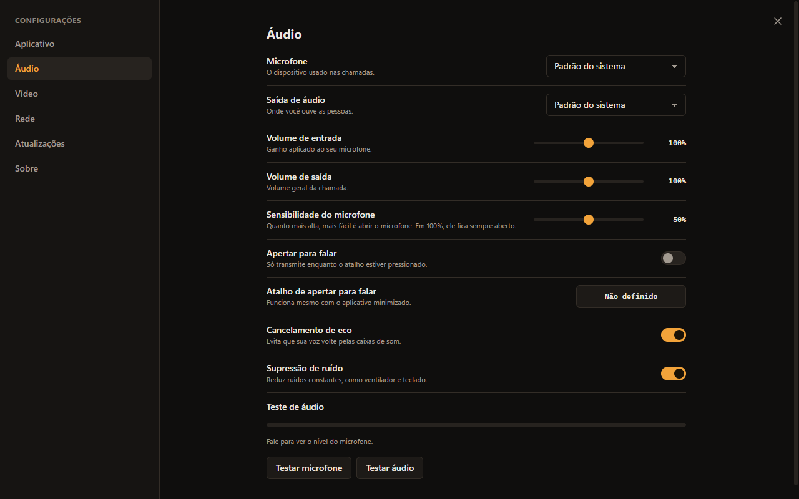
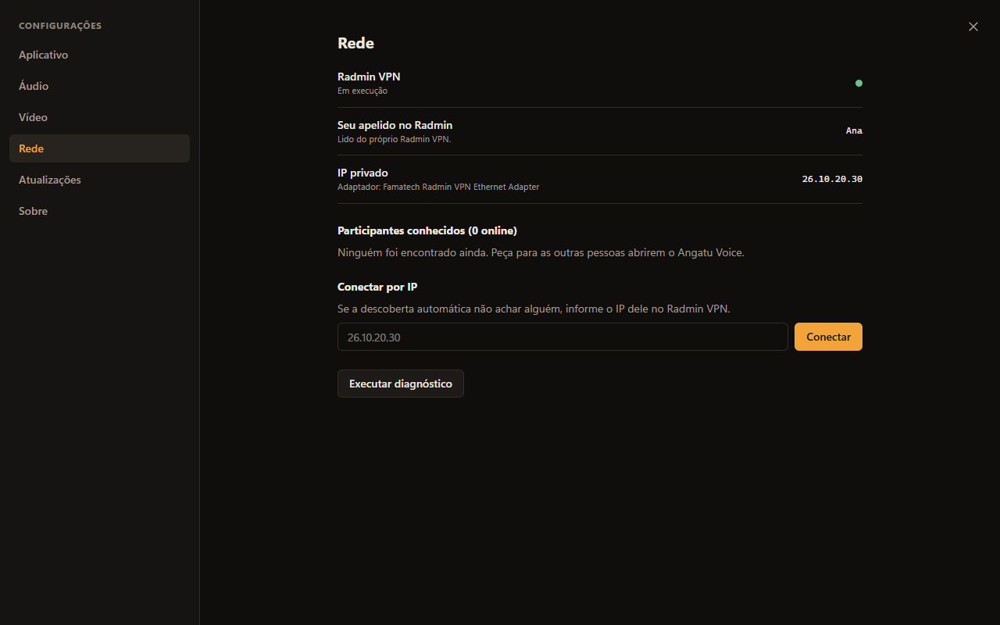
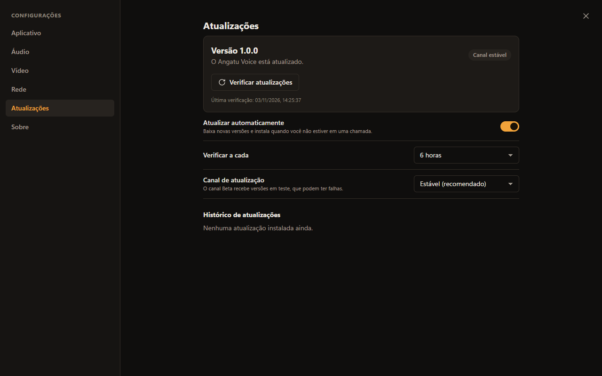

<p align="center">
  
</p>

<h1 align="center">Angatu Voice</h1>

<p align="center">
  Voz, texto e compartilhamento de tela entre quem está na mesma rede do <b>Radmin VPN</b>.<br>
  Privado, leve e sem servidor de ninguém no meio.
</p>

<p align="center">
  <a href="https://github.com/LuanVictorGit/AngatuVoice/releases/latest/download/AngatuVoice-Setup.exe">
    
  </a>
</p>

<p align="center">
  <sub>Windows 10 ou 11 (64 bits) · o Java já vem dentro do instalador · requer o <a href="https://www.radmin-vpn.com/br/">Radmin VPN</a> instalado</sub>
</p>

<p align="center">
  
</p>

## Como funciona

1. **Instale e abra.** O instalador é por usuário, não pede administrador e já configura o início com o Windows (você pode desmarcar).
2. **Entre na sua rede do Radmin VPN.** O Angatu Voice reconhece o Radmin sozinho, lê o seu apelido e começa a procurar quem mais está na rede.
3. **Converse.** A *Rede Radmin* é o grupo de todo mundo da sua rede. Para um círculo menor, crie um grupo privado e mande o convite só para quem deve entrar.
4. **Chame no voz.** Um clique em *Chamar* abre a chamada, com indicador de quem está falando, volume por pessoa e atalhos que funcionam até com o aplicativo minimizado.
5. **Mostre a sua tela.** Em 720p ou 1080p, a 30 ou 60 quadros por segundo; se a rede não acompanhar, a qualidade desce sozinha e volta quando melhora.

Tudo trafega direto entre os computadores, dentro do Radmin VPN, com identidade verificada e conexão cifrada.

## Um olhar por dentro

<table>
  <tr>
    <td width="50%"><br><sub><b>Tema claro e escuro.</b> Grupos, conversas privadas e participantes na mesma tela.</sub></td>
    <td width="50%"><br><sub><b>Áudio sob controle.</b> Microfone, saída, sensibilidade, cancelamento de eco, supressão de ruído e teste.</sub></td>
  </tr>
  <tr>
    <td width="50%"><br><sub><b>Rede.</b> Status do Radmin, seu IP privado, participantes e conexão manual por IP.</sub></td>
    <td width="50%"><br><sub><b>Sempre atualizado.</b> Novas versões chegam sozinhas, verificadas e com volta automática se algo falhar.</sub></td>
  </tr>
</table>

<p align="center">
  <br>
  <sub>A interface se adapta a janelas estreitas.</sub>
</p>

## O que tem dentro

- **Grupos privados** com convite, conversas individuais, histórico salvo no seu computador e mensagens pendentes entregues quando a pessoa volta.
- **Chamadas** individuais e em grupo, com baixa latência, cancelamento de eco e supressão de ruído.
- **Atalhos globais** para apertar para falar, silenciar microfone ou áudio, entrar e sair da chamada.
- **Bandeja do sistema**, notificações e início automático com o Windows, sempre sob o seu controle.
- **Atualização automática** pelas versões publicadas neste repositório, com assinatura digital, verificação de integridade e volta para a versão anterior se a nova não abrir.

## Para quem desenvolve

```powershell
mvn -B test
mvn -q -B -DskipTests package
java --enable-native-access=ALL-UNNAMED -jar target\angatu-voice-1.1.1.jar
```

Requisitos: JDK 25 (com `jpackage`), Maven 3.9+ e o binário do [Tailwind](https://github.com/tailwindlabs/tailwindcss/releases) em `tools\bin\`. O pacote e o instalador saem de `tools\package.ps1` e `installer\angatu-voice.iss`; o GitHub Actions faz tudo isso ao publicar uma tag `vX.Y.Z`.

- [Arquitetura, protocolo, integração com o Radmin e segurança](docs/ARQUITETURA.md)
- [Atualizador, manifesto e rollback](docs/ATUALIZADOR.md)
- [Versionamento e como publicar uma atualização](docs/VERSIONAMENTO.md)
- [Histórico de versões](CHANGELOG.md)

---

<p align="center"><sub>Desenvolvido por <b>Angatu Sistemas</b></sub></p>
